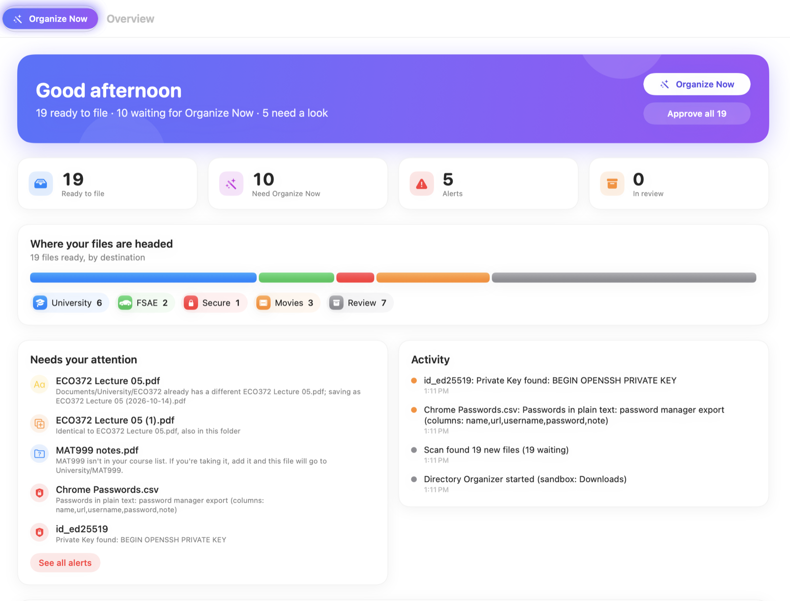
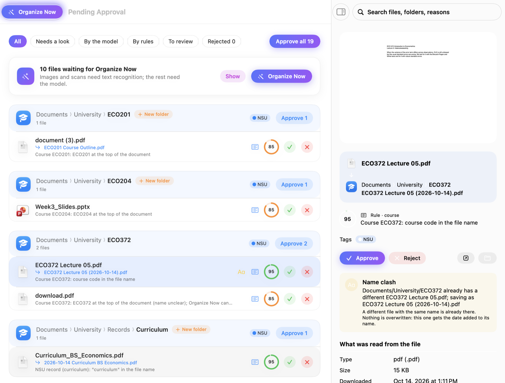
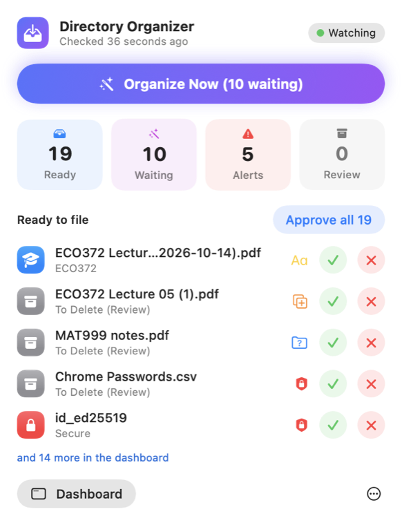

# Directory Organizer

An offline macOS menu-bar app that sorts your downloads into the right folders, renames unclear
files and adds Finder tags. Simple rules handle the obvious cases; Apple's on-device model handles
the rest. **Nothing moves until you approve it, and every move can be undone.**



| Pending approval, grouped by destination | Menu bar |
|---|---|
|  |  |

## What it does

- **Watches Downloads** and sorts new files within seconds with rules: course files by course code,
  NSU records (dated), FSAE files, films and TV (cleaned names), installers, code projects.
- **Organize Now** (menu bar button) does the heavy work on demand: text recognition for images and
  scans, and Apple's on-device model for files no rule fits and for unclear names. It can propose
  new category folders ("Manuals", "Bills").
- **Safety first, in code, not left to the model:** never deletes, never overwrites (dated names
  instead), duplicates by content hash only, password exports / recovery phrases / private keys
  detected and reported, every model answer checked against the folders that exist.
- **Undo anything:** a write-ahead move log puts files back exactly as they were (name, folder, tags).
- **Fully offline:** Apple's model runs on your Mac; nothing is uploaded.

## Install

Download the latest `.zip` from [Releases](../../releases), unzip, and move the app to Applications.
It isn't notarized, so the first time: right-click the app → **Open** → **Open**.

Requires macOS 27 on Apple silicon; Apple Intelligence on for the model (System Settings → Siri).

> **Preview:** the app currently works only on a test sandbox (`~/Developer/directory-organizer/TestData`,
> created with `swift run make-testdata`); your real folders are locked until real use is switched on.

## Build from source

```sh
swift run make-testdata              # sandbox: fake downloads + a stand-in home folder
./scripts/build-app.sh --open        # build and open the app
./scripts/test.sh                    # run the tests
swift run organize plan TestData/Downloads   # or use the command-line tool
```

Only the Command Line Tools are needed, not Xcode.

## Docs

- [How it works](docs/how-it-works.md): the pipeline, rules, safety checks, the model, the design
- [CLI cheatsheet](docs/CLI-CHEATSHEET.md): every command

## License

[MIT](LICENSE) © 2026 Niso Ryu
