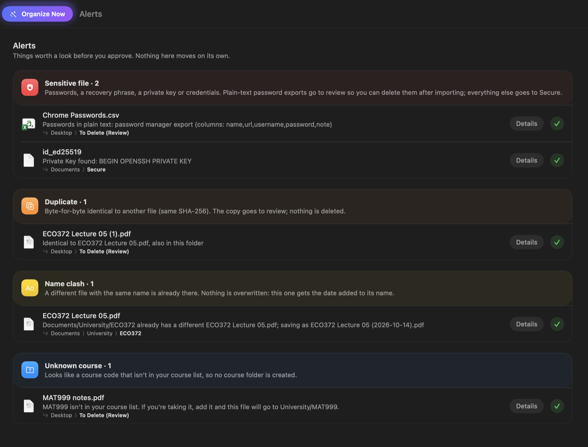

# How Directory Organizer works

The full details. For a quick start, see the [README](../README.md).

An offline macOS app that sorts new downloads into the right folders, with Finder tags.
Simple deterministic rules handle the obvious cases. A small on-device language model is
used only for files the rules can't place.

**Core principle:** the model never moves files or runs commands. It only *suggests* a
destination, a name and tags. Swift code checks every suggestion and performs the move.
When the model is unsure, the file simply waits in Downloads; nothing is ever lost.

```
~/Downloads → facts → rules → model (leftovers only) → proposed action → checks → plan → you approve → move + undo log
```

## Status

| Milestone | What | State |
|---|---|---|
| 1 | Fact extraction, rules engine, plan-only CLI, stub classifier | ✅ |
| 2 | Apply moves, undo log, Finder tags, safety checks, creating folders and renaming | ✅ |
| 3 | Apple's on-device model for leftovers: folders, new folders, names (text and images); replaced by Qwen3 (MLX B) | ✅ |
| 4 | Menu-bar app + dashboard, Downloads watcher, approval UI, notifications, review reminder every 8 hours | ✅ |
| 5 | Organize Now: the heavy work (text recognition + model) on demand from the menu bar | ✅ |
| 6 | Evaluation on a labeled test set (`organize eval`, MLX F) | ✅ |

**Next (approved 2026-10-14):** a model-led app with few rules, in phases:
1. Folders in Downloads: read inside, safety-checked, left alone while changing, unpacked when the model says so ✅ (0.7.0-dev)
2. Folder profiles learned from your own folders (replacing the fixed folder list and personal prompt) ✅
3. Grouping: similar files are placed together; a new folder only for a new file plus earlier files ✅ (decisions with the catalog: MLX E)
4. Evaluation harness (the old Milestone 6), before any autonomy ✅ (`organize eval`: MLX F)
5. Only universal rules left (safety, installers, code projects, incomplete downloads, plus films/TV and images by type); NSU/FSAE/course rules removed ✅ (0.7.0)
6. Earned autonomy: per-folder trust from your approvals; undo and corrections lower it

## Try it

Needs macOS 27, Swift 6 and full Xcode with the Metal toolchain, which compiles MLX's GPU shaders
(both `swift build` and `xcodebuild` do; without the toolchain the model can't run, and files no
rule can place go to review). One quirk:
the macOS 27 SDK declares SwiftUI's `@State` also as a macro whose plugin only ships with Xcode,
so the app uses `@ViewState` (an alias for the property wrapper).

```sh
swift run make-testdata                      # builds TestData/Downloads and TestData/Home
swift run organize plan TestData/Downloads   # shows the plan; nothing is moved
swift run organize apply TestData/Downloads  # shows the plan, asks: all / one by one / cancel
swift run organize undo --last               # puts the last batch back exactly as it was
swift run organize log                       # history of moves and undos
./scripts/test.sh                            # runs the tests
```

### The app

```sh
./scripts/build-app.sh --open    # builds build/Directory Organizer.app and opens it
```

It also builds the CLI as `build/cli/organize`, next to the same shader bundle (`swift run organize`
works as well). `organize model-check [--download]` loads each MLX model and runs a short sample
(valid JSON, speed, memory). Settings → On-device models downloads them in the app; they're kept
in `~/Library/Application Support/DirectoryOrganizer/Models`, pinned to fixed revisions.

A tray icon appears in the menu bar (with the number of files waiting) and the dashboard opens.
Notifications only work in this bundled app, not with `swift run`.

All commands, plus macOS commands for checking tags and attributes: **[docs/CLI-CHEATSHEET.md](CLI-CHEATSHEET.md)**.

`organize` refuses to read your real home, Downloads, Documents, Desktop, Pictures, Movies or
Music folders until real use is switched on deliberately.

## What it reads (no model)

- Name, extension, size, dates (including when the file was downloaded)
- **Download source** (`kMDItemWhereFroms`), a strong signal, shown to the model and used to shortlist folders that hold files from the same site
- Text: PDFKit for PDFs, with **OCR for scanned PDFs** that have no text layer; the XML inside
  .docx/.xlsx/.pptx; macOS's own converter for .rtf/.doc/.odt; Vision OCR for images; the first
  256 KB of text files (UTF-8 or UTF-16) for the safety checks, of which the model sees an excerpt.
  Not read (known limit): .pages, .numbers, .key, .xls, .ppt, .ods, .odp.
- Video length and title from the file header (the video itself is never analyzed);
  photo date and camera from EXIF; whether an image is a screenshot
- What's inside zip archives (to spot code projects)

## Rules, in order (first match wins)

1. **Sensitive files** (always first, always reported):
   - CSV/JSON with password-manager columns (header in the first lines, any size) → review
   - recovery phrases: 12+ BIP-39 words in a row, or 11+ among 13 (one misread), even in a photo → Secure
   - private keys (PEM, OpenSSH, SSH2/PuTTY, any case) and credential files (`.env` with secrets,
     `.netrc`, `.git-credentials`, `.npmrc` tokens, AWS keys; also inside zips and folders) → Secure
   - a folder with any of these inside (hidden files included), or too big to check fully → review
   - unreadable (locked PDF, broken document, failed text recognition) → review: unread isn't clean
2. **Installers, disk images, firmware** (.dmg .iso .img .pkg .bin …) → review
3. **Code projects** (zips containing Package.swift, .git, package.json …) → review
4. **Empty folders** → review
5. **Videos**: films → `Movies/Films/Avengers Infinity War.mpeg`, episodes →
   `Movies/TV Shows/<Show>/Show S01E04.mkv`, short clips → `Movies/Clips`. Release clutter
   (4K, BluRay, x265 …) is removed; a year is kept only if it was in the name.
6. **Images** → `Pictures/Downloaded Images`. In Organize Now the vision model looks at them first:
    a document-like image (receipt, bill, ticket, letter, chart, slide…) skips this rule and is
    decided like a document; a picture (photo, meme, screenshot of an app) stays here, with a real name.
7. Anything else → the model (below). If it's unsure, the file waits in Downloads; without the model: review.

## Your folders, learned (folder profiles)

The app doesn't come with a list of your folders. Every scan reads the folders under Documents,
Pictures, Movies and Music (two levels deep; a root itself only if files sit directly in it) into
**profiles**: how many files, of which kinds, the newest file names as examples, the sites they
were downloaded from, and the Finder tags most of them carry (2+ files and 60%+).

- **Purpose:** Organize Now has the model read a profile and write what the folder is for
  ("PDF lecture notes and problem sets"). Only from real files: an empty folder gets no purpose,
  since one guessed from a name (an acronym read as something else) misleads every later choice. A
  purpose is rewritten when the folder has grown or shrunk by half (and 3+ files).
- **Tags** of a folder are the ones most of its files carry, so files placed there match them.
- Fixed in code are only the two folders the safety rules rely on: the review folder and
  `Documents/Secure` (keys, recovery phrases, identity documents; *not* bills or receipts).
- Profiles are kept in `folder-profiles.json` next to the move log (`TestData/` in the sandbox,
  Application Support for your real folders) and shown on the Folders page.
- **Shortlist:** each file is offered the 25 folders most likely to fit (shared words with the
  folder's name, purpose and examples; same download site; same kind of file), so the prompt
  fits the model's small context window. New folders are still checked against all folders.
- **Corrections:** a model move you undo is remembered ("notes.txt does not belong in
  Documents/Manuals") and up to 3 relevant ones are shown to the model next time. Moves you keep
  teach by example: the file becomes one of the folder's examples.

## Similar files, placed together (decisions with the catalog)

In Organize Now, every leftover (no rule, not a duplicate, readable) gets a **card** from the
model (its kind, issuer, subject, date, people, a suggested name and a one-line summary) and an
embedding of that card. Then each leftover gets **one decision**, oldest first. The model sees the
new file, its **5 nearest earlier files** from the catalog (filed by the app, or waiting in
Downloads; no similarity cut-off) with the folder each is in, and your folders with their purposes:

- **join:** the file goes into an existing folder. It may take earlier files along (`move_earlier`).
- **new_folder:** a folder for the new file *and* at least one earlier file, under the right parent
  for its type ("Documents/Manuals"). A new folder is never made for one file.
- **wait:** nothing belongs with it yet. It stays in Downloads, carded and catalogued, listed as
  *waiting for a match*, and isn't asked about again. It's reconsidered only when a new similar
  file lists it among its earlier files.

An earlier file moves only if the chosen folder's name describes it as well as the new file,
judged for each earlier file on its own; when none passes, the model waits instead of making a
folder (added in 0.7.0, after the evaluation showed bills pulled into "Newsletters").

Within one run, each decided file joins the catalog straight away (waiting, or "proposed" for its
folder), so the second of two manuals sees the first and can make a folder for both. An earlier
file already placed by this run stays with that decision (the first one wins).

**Moving earlier files always asks first.** The new file and the earlier files moving with it are
one **group** in Pending ("earlier file" marks them): approved or rejected together, never
auto-applied, applied as one batch (so undo puts the whole group back), and skipped whole if any of
its files changed or went away since the plan. Only files the app filed itself, or files waiting in
Downloads, can ever be pulled; files you filed yourself are never in the catalog.

`organize describe <file>…` prints a file's card.

## The vision model (Qwen3-VL 4B, for images)

`mlx-community/Qwen3-VL-4B-Instruct-4bit` (3.1 GB), chosen over Gemma 3 4B by `organize image-eval`
(see docs/mlx-plan.md, Milestone C). Organize Now's **image phase** comes first: the images only the
image rule would place (not sensitive, not duplicates) get a card, from the picture (shrunk to at most
1,024 px a side) plus any text recognition found, thinking off, ~3–6 s each. Then the vision model is
released, before Qwen3 8B loads: the two never share memory (the engine has one slot for a large
model). An image it can't describe, or every image when it isn't downloaded, goes by the image rule.
The card's kind decides the way: document words (receipt, bill, ticket, letter, chart, slide…) send
the image to the folder decision; anything else is a picture.

## The catalog (embeddings, so similar means similar in meaning)

`catalog.jsonl` (next to the move log: `TestData/catalog.jsonl` in the sandbox, Application Support for
your real home) keeps one line per file a model looked at: its content hash, its card, the card as one
line, and that line's embedding from `mlx-community/Qwen3-Embedding-0.6B-4bit-DWQ` (1,024 numbers stored as
Float16, ~2 KB). It's append-only, like the move log; the newest line per file wins. Sensitive files,
duplicates and folders are never in it.

- **Where a file is now isn't stored:** it's worked out from the move log and the disk each time the
  catalog is read. Moved by the app and still there → *filed*; undone → *undone*; never moved and still
  in Downloads → *waiting*; not where it should be → *gone*. Only filed and waiting files are offered as similar.
- **Earlier files for decisions:** the 5 nearest live files to a new file's embedding (see above).
  Without the embedder there are no earlier files: a file can join a folder or wait, but no new
  folder can be made.
- **Nothing is described twice:** a file found in the catalog by its hash (waiting in Downloads, or
  downloaded again) gets its old card back instead of a new model question.
- **Back-fill:** each Organize Now cards and embeds up to 40 earlier files the app filed that aren't
  catalogued yet (newest first; not review or safety cases), read where they are now. Entries made by
  another embedder are embedded again from their stored line.
- `organize catalog` lists it; `organize similar <file>` shows the 5 nearest files with their scores.

## The model (Qwen3 8B, on this Mac with MLX)

`mlx-community/Qwen3-8B-4bit-DWQ`, downloaded once into
`~/Library/Application Support/DirectoryOrganizer/Models` and pinned to a fixed revision. Organize Now
loads it at its first question (about 5 GB of memory) and releases it at the end. Used only where
rules can't decide, and only ever *suggests*:

- **Cards:** what a leftover file is (kind, issuer, subject, date, people, suggested name, summary),
  thinking off, ~5 s. One card per file serves the catalog, decisions and naming.
- **Leftover files:** join / new_folder / wait, with the nearest earlier files (above), thinking on
  (~1 min: the benchmark showed folder decisions need it). The prompt is the benchmark's (11/12),
  with your folders' purposes and your corrections added.
- **Folders in Downloads:** keep together or unpack (thinking on); **your folders:** what each is for
  (thinking off).
- **Unclear names:** the card's suggested name, trusted when the file has text or the vision model
  saw it.
- It never sees the file system and never acts. It receives a text summary of the facts, one fresh
  chat per question, greedy (repeatable) sampling. Answers are JSON; one that's invalid (not JSON,
  a folder that isn't on the list, a new folder under the wrong parent) is sent back with what's
  wrong, at most twice; then the file waits in Downloads.

Swift then checks every answer:
- **join:** the folder must be one that was offered. **new_folder:** right parent for the file
  type, at most 2 levels, a sane name, not existing yet, and at least one earlier file that isn't
  already there. A near-duplicate name reuses the existing folder: "Manual" → "Manuals".
- `move_earlier` may only name the earlier files listed; ones already in that folder are dropped.
- Never Downloads, the review folder or `Documents/Secure` (Secure is only for what the safety
  checks find). Anything rejected means the file waits, with the reason shown.
- **Tags come from the folder** (the ones most of its files carry), never from the model.
- The answer starts with its `reason`: a reason written after the choice would only defend it.
- **Unreadable is not clean:** if text recognition fails (it's retried once), the file can't be
  checked for sensitive text, so it goes to review, never into a folder as if it were safe.
- the answer has no confidence of its own: a join is shown as 85%, a new folder as 80%.
- if the model isn't downloaded, or MLX's GPU shaders weren't built, leftovers simply go to review.
- sensitive files (safety rules) are never renamed by the model.

`organize model` shows whether the model can run; `--no-model` runs rules only.

## Evaluation (`organize eval`)

A regression check for any change to a prompt or a model, run by hand (`build/cli/organize eval`;
results in `eval-results/<date>.json`, not committed). Everything happens in a new temporary folder.

- **Test set:** the MLX benchmark's 27 text files (15 earlier, 12 new) and 12 scenarios, copied into
  TestDataKit (`BenchmarkCorpus`), with one change: there's no Documents/Unsorted, so the earlier files
  that sat there wait in Downloads. Plus C's 18 images.
- **Parts:** cards (kind and issuer right?), decisions (each scenario's five earlier files, as the
  benchmark gave them; ✓ / ~ / ✗ by the benchmark's rules), embeddings (recall@3 of the card lines,
  top-1 scores), images (kind, key fact, name, document or picture), and with `--pipeline` the real
  Planner: the filed earlier files moved into place by the Applier and catalogued, the rest waiting in
  Downloads, then each new file planned on its own, scored by the same rules, with a check that the
  files it belongs with were among the 5 nearest it was shown. Plus speed and peak memory.
- **Compared with** the benchmark's numbers (⚠ when below) and the last saved run (what changed).
- **Never tuned on:** a test fails if a prompt, or any code in OrganizerCore, names something from
  the test sets (issuers, people, places).

## Safety, in code

- Never deletes. Never overwrites: a different file with the same name gets the date added
  (`Report (2026-10-13).pdf`).
- Duplicates are identical SHA-256 content only, never just the same name. A duplicate is
  reported and parked in review.
- Every destination is checked: it must be inside Documents, Pictures, Movies, Music,
  Developer or the review folder; no `..`, no hidden folders, no `Library`, never inside the
  Photos library or an app bundle; at most 3 new folders per file.
- Model suggestions below the confidence threshold, or with tags that aren't on the allowlist,
  are rejected.
- Downloads still in progress (`.crdownload`, `.download`, `.part`) are skipped.

## Applying and undoing

- **Checked again just before moving:** a file whose size or modification date changed since
  the plan (still downloading, edited) is skipped. The destination is validated again too.
- **Never overwrites:** the move is a single exclusive `renamex_np(RENAME_EXCL)` call, so it fails
  if anything is at the destination, even a file that appeared a moment earlier. Between disks it
  copies, verifies the SHA-256, and only then removes the original.
- **No escaping the home folder:** symlinks are resolved, so a linked folder can't redirect a file
  elsewhere.
- **Write-ahead log:** each move is logged as "pending" (fsync'd) before the file is touched and
  "done" afterwards, in append-only JSON Lines (`TestData/moves.jsonl` in the sandbox,
  `~/Library/Application Support/DirectoryOrganizer/moves.jsonl` for your real folders). An interrupted
  run is settled on the next start by checking where the file actually is. A line cut short by a
  crash is skipped (and reported), so it never hides the rest of the history.
- **Tags:** `com.apple.metadata:_kMDItemUserTags`, a binary plist of `"Name\nColor"` strings
  (e.g. Personal 3, Secure 6). Tags already on the file are kept.
- **Origin note:** each moved file gets a small `io.github.n1soryu.directory-organizer.origin`
  attribute with its original path.
- **Undo restores the original state exactly:** original folder and name, original tags, origin
  note removed, and folders the move created removed again (only if empty; `rmdir` refuses
  otherwise). If the original name has been taken since, the file comes back with the date
  added rather than overwriting.

## Folders in Downloads

A downloaded folder is read all the way down (up to 6 levels and 2,000 items; hidden items and
bundle contents skipped): file count, kinds, total size, a sample of paths, and the newest change
anywhere inside.

- **Safety inside:** every file inside (up to 300) gets the same checks as a file in Downloads. A
  folder with a password export, key or recovery phrase anywhere inside goes to review whole, with
  an alert per file, and is never unpacked.
- **Still changing?** A folder that changed in the last 30 s is skipped ("still being unzipped or
  copied?") and the app looks again once it should have settled. When moving, the folder's
  size and date are the whole tree's, so a change anywhere inside since planning skips the move.
- **Rules first:** code projects (`.git`, `package.json`, `Package.swift`…) and empty folders go to
  review whole.
- **Keep together or unpack (Organize Now):** for other folders the model is asked whether the items
  belong together (a project, an album, a course pack) or are separate things. Unpacked folders
  are replaced in the plan by what's inside (2 levels at most, 200 files at most), each item
  placed on its own; the emptied folder later goes to review. Without the model nothing is unpacked.
- A plain folder has no extension: `Dune.Part.Two.2024.1080p.WEB-DL` is all name.

## Quick scans and Organize Now

The app splits the work in two:

- **Quick scan, automatic.** Whenever something lands in the watched folder: rules only, no text
  recognition, no model, so it takes seconds and barely uses the Mac. Courses, records, films,
  installers, password exports, duplicates and the like show up ready to approve right away.
- **Organize Now, when you press it** (menu bar, dashboard toolbar, or ⇧⌘O). The heavy work:
  text recognition for images and scanned PDFs, and the model for files no rule fits and for
  unclear names, asked fresh. Images are looked at by the vision model first. While it runs (in the app, or
  `organize plan`/`apply` with the models), the Mac doesn't idle-sleep; the display still can. Progress shows in the menu bar (percentage, current file and step,
  elapsed time) with **Cancel** (⌘.); cancelling is safe because planning only reads. A
  notification summarizes the run, and its results stick to each file until it changes.

Files the quick scan can't decide are listed as **waiting for Organize Now**. Every image and
scan waits, even an ordinary-looking photo: without text recognition a photographed recovery
phrase can't be told apart from a holiday picture, so nothing unread is ever filed.

`organize plan <folder> --quick` shows what the quick scan sees.

## Design

One idea runs through the app: **lanes**. Every destination has a color and a symbol
(Secure red, Essays purple, Movies orange, Pictures pink, Review gray),
used for the destination bar on Overview, the groups on Pending Approval, the menu-bar rows and
the folder cards. The main action, **Organize Now**, is the one gradient button. Pages are
rounded cards on the window background, in light and dark mode.

The icon (three lane-colored files dropping into a tray, with a sparkle) is drawn in code:
`swift scripts/make-icon.swift` regenerates `Resources/Icon/AppIcon-1024.png` and
`Resources/AppIcon.icns`.



## The app (menu bar + dashboard)

**Menu bar (compact):** status (watching / scanning / paused), **Organize Now** (with how many
files are waiting, or the progress and Cancel while it runs) and the last run's summary, counts
(pending, waiting, alerts, in review), the top alerts, the next files with ✓ approve / ✕ reject, Approve All, Scan, Pause,
Open Dashboard.

**Dashboard (detailed):**

| Page | Shows |
|---|---|
| Overview | a header with the state and the main actions, four counts, **where your files are headed** (a bar split by destination), what needs attention, activity, last quick scan and Organize Now, model status |
| Pending Approval | files waiting for Organize Now, then every proposed move **grouped by destination** (approve a whole group at once), with filters, search and ⌘-click multi-select. Each row: alerts, original and new name, the reason, who decided, a confidence ring, approve / reject. Rejected files have their own filter. The detail panel has a Quick Look preview, the plan, alerts explained, and **every fact read from the file**: source URLs, dates, title, pages, image info, archive contents, and the text or OCR the decision was based on |
| Alerts | grouped by kind (sensitive, duplicate, rejected suggestion, name clash), each explained |
| History | every batch and move from the log, with undo per move or per batch |
| Review Folder | what's waiting in `To Delete (Review)` and why, put-back, reminder schedule |
| Folders | the folders files can go to, what each is for, its tags, item counts, folders the app created |
| Settings | sandbox or real folders, watching, model on/off and status, auto-apply per category, notifications and reminder interval, access to your real folders |

**How it runs:**
- **Watching:** FSEvents on the watched folder. A burst of changes (a download being written)
  becomes one quick scan a few seconds later; a scan requested during a scan (or during
  Organize Now) runs right after it.
- **Rejected files** stay where they are and stay out of the plan until they change.
- **Notifications:** sensitive files right away, new files ready to file (when the app isn't in
  front), auto-filed files, and the **review folder reminder every 8 hours** while it isn't empty
  (4/8/12/24 h in Settings). Clicking one opens the matching dashboard page.
- **Auto-apply** (off by default, per category): only rule decisions at 90%+ with no alerts.
  Model decisions, sensitive files and duplicates always wait for you.
- **Real folders stay locked:** the app refuses ~/Downloads, Documents, Desktop, Pictures, Movies
  and Music, even if chosen in Settings. Settings shows the permission status for them
  ("Check Access" triggers the macOS prompts) and links to Full Disk Access, for when real use is
  switched on.
- Settings are saved in `~/Library/Application Support/DirectoryOrganizer/settings.json`
  (debug runs use a throwaway copy); the sandbox move log is shared with the `organize` command
  (`TestData/moves.jsonl`).
- **Real folders:** "Switch to My Real Folders" (with a confirmation) watches `~/Downloads` and files
  into your home folder. Only items that arrived in Downloads after the switch are considered
  (`Planner.onlyAddedAfter`); auto-filing and earlier rejections are reset. The `organize` command
  stays sandbox-only.

## Layout

```
Sources/OrganizerCore/   facts, safety, rules, planning, applying (no UI)
  Facts/       FactExtractor, PDF/Office/OCR/media readers, xattrs, hashing
  Naming/      unclear-name check, name cleaning, film/TV name parsing
  Safety/      sensitive-file detector, BIP-39 wordlist
  Rules/       rules engine and the rules above
  Classify/    FileClassifier protocol, MLXClassifier (questions to Qwen3), VisionCardWriter (image cards),
               FactSummary
  Catalog/     catalog entries, state from the move log, nearest-neighbour search, grouping by meaning
  LocalModels/ LanguageModel protocol, thinking budget, lenient JSON + retries, model list and store
Sources/OrganizerMLX/    the MLX engine: downloads, loads and runs the models (GPU)
  Planning/    Planner (duplicates, clashes, new folders), DestinationValidator
  Apply/       Applier, Undoer, SafeMove, MoveJournal (write-ahead log), FinderTags
  Config/      folder layout, FolderCatalog (folders offered to the model),
               FolderProfile (what your folders hold, learned)
Sources/TestDataKit/     generates realistic fake downloads + expected results, the vision evaluation's image set, and
                         the benchmark's corpus and scoring (BenchmarkCorpus, for organize eval)
Sources/organize/        the CLI (plan, apply, undo, log, model, facts, catalog, similar, eval)
Sources/DirectoryOrganizer/  the menu-bar app: AppModel (state, scans, moves), Views/ (dashboard pages)
  App/ (in OrganizerCore) FolderWatcher (FSEvents), AppSettings, AutoApplyPolicy, ReviewReminder
docs/                    this file, the CLI cheatsheet
```

Test data (fake password exports, keys and recovery phrases included) is generated locally and
never committed.
